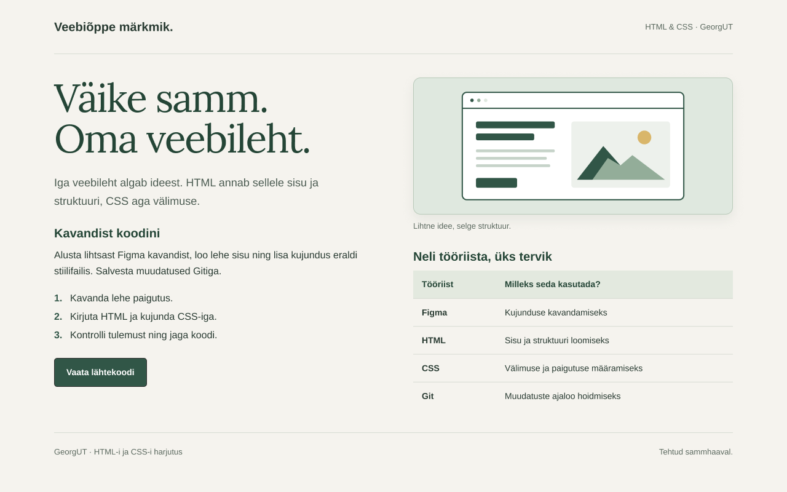

# Veebiõppe märkmik

HTML-i ja CSS-i 6. praktikumi töö.

Lehel on kaks sisutulpa, illustratsioon ja tabel. Kujundus on failis `style.css`. Telefoni vaates paiknevad tulbad üksteise all.

Lehe vaatamiseks ava `index.html` brauseris.

[Figma kavand](https://www.figma.com/design/daw9h7ZoVZkBRAV7LbDJgg?node-id=5-2)

Töölehe küsimuste vastused on failis [VASTUSED.md](VASTUSED.md).

CSS on W3C validaatoriga kontrollitud: 0 viga ja 0 hoiatust.
